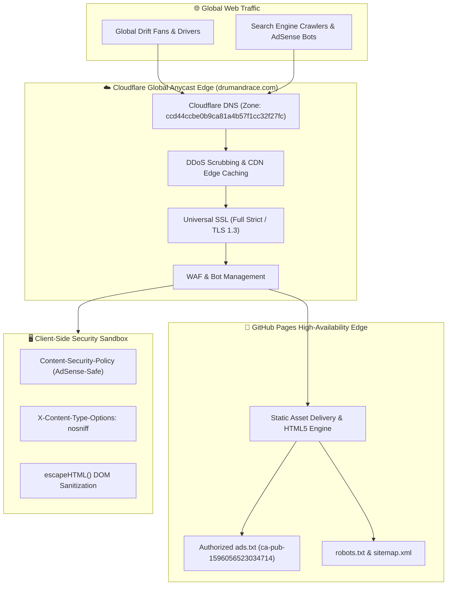

# 🏁 DRUM & RACE // Worldwide Drift Culture, Homebrew Tuning & Track Events

```text
 ██████╗ ██████╗ ██╗   ██╗███╗   ███╗    ███████╗    ██████╗  █████╗  ██████╗███████╗
 ██╔══██╗██╔══██╗██║   ██║████╗ ████║    ██╔════╝    ██╔══██╗██╔══██╗██╔════╝██╔════╝
 ██║  ██║██████╔╝██║   ██║██╔████╔██║    ███████╗    ██████╔╝███████║██║     █████╗  
 ██║  ██║██╔══██╗██║   ██║██║╚██╔╝██║    ╚════██║    ██╔══██╗██╔══██║██║     ██╔══╝  
 ██████╔╝██║  ██║╚██████╔╝██║ ╚═╝ ██║    ███████║    ██║  ██║██║  ██║╚██████╗███████╗
 ╚═════╝ ╚═╝  ╚═╝ ╚═════╝ ╚═╝     ╚═╝    ╚══════╝    ╚═╝  ╚═╝╚═╝  ╚═╝ ╚═════╝╚══════╝
```

> **[OFFICIAL PRODUCTION REPOSITORY]**  
> *The premier global digital hub for grassroots drift racing, homebrew garage modifications, worldwide track radar, and chassis alignment geometry.*  
> Engineered by **Efrain Rivas** — Senior Enterprise Infrastructure Architect.

---

## ⚡ Live Telemetry & Badges

[](https://drumandrace.com)
[](https://digdast.github.io/drumandrace-website/)
[](https://drumandrace.com)
[](https://dash.cloudflare.com)
[](https://drumandrace.com)
[](https://drumandrace.com/ads.txt)
[](https://tailwindcss.com)

---

## 🌟 Core Platform Highlights

1. **Worldwide Drift Radar & Circuit Directory**:
   - Comprehensive event guide across **Japan** (Ebisu Circuit Matsuri, Meihan Sportsland, Nikko Circuit), **North America** (Formula Drift Irwindale, Final Bout, Drift Appalachia), and **Europe** (Drift Masters Grand Finale, Mondello Park, Iron Drift King).
2. **Grassroots Garage Showcase & Community Builds**:
   - Real missile builds documented with telemetry specs: BMW E46 330i Turbo, Nissan Silvia S14 Koguchi Spec, Toyota GR86 FA24, and Mazda Miata NA Turbo.
   - Technical teardowns of steering lock kits (Wisefab, SLR Speed, FDF), dual-caliper hydraulic handbrakes, and reinforced rear subframes.
3. **Drift Setup & Chassis Alignment Calculator**:
   - Interactive front negative camber, rear camber, positive caster, Ackerman angle, and cold tire pressure simulator for dry asphalt, intermediate, and rain conditions.
4. **Google AdSense Revenue Engine**:
   - High CPC automotive racing keywords, responsive leaderboard ads, in-feed missile build units, and 100% verified authorized `ads.txt` integration (`pub-1596056523034714`).
5. **Production Security Architecture**:
   - Zero-trust edge protection, Content Security Policy (CSP), automated DOM XSS sanitization (`escapeHTML`), and origin cloaking.

---

## 🏗️ High-Availability Edge Architecture



---

## 🛡️ Security Hardening & Compliance

- **Content-Security-Policy (CSP)**:
  `default-src 'self' data: blob: https:; script-src 'self' 'unsafe-inline' 'unsafe-eval' https://pagead2.googlesyndication.com https://*.googlesyndication.com https://*.google.com https://*.doubleclick.net https://cdn.tailwindcss.com https://unpkg.com; style-src 'self' 'unsafe-inline' https://fonts.googleapis.com; font-src 'self' data: https://fonts.gstatic.com; img-src 'self' data: blob: https:; connect-src 'self' https://pagead2.googlesyndication.com https://ep1.adtrafficquality.google https://googleads.g.doubleclick.net https://*.google.com https://*.googlesyndication.com; frame-src 'self' https://googleads.g.doubleclick.net https://tpc.googlesyndication.com https://pagead2.googlesyndication.com https://*.google.com;`
- **Clickjacking & MIME Protection**: `X-Content-Type-Options: nosniff` and `Referrer-Policy: strict-origin-when-cross-origin`.
- **Hardware Privacy**: `Permissions-Policy: camera=(), microphone=(), geolocation=()`.
- **DOM XSS Sanitization**: User-submitted chassis data and community specs pass through HTML entity encoders before DOM insertion.
- **Privacy & Compliance**: Integrated GDPR / CCPA cookie consent and privacy policy modals.

---

## 📂 Repository Topology

```text
drumandrace-website/
├── index.html        # High-performance single-page web app with Tailwind & Lucide
├── ads.txt           # Google AdSense publisher validation (pub-1596056523034714)
├── robots.txt        # Universal search engine indexing directive
├── sitemap.xml       # Canonical XML sitemap for SEO discovery
├── CNAME             # GitHub Pages custom domain binding (drumandrace.com)
├── static/           # Vector branding assets, SVGs, and logos
└── README.md         # Architecture, security & telemetry documentation
```

---

## ⚖️ License & Attribution

Designed and maintained by **Efrain Rivas**.  
All rights reserved © 2026 **DrumAndRace.com**.
